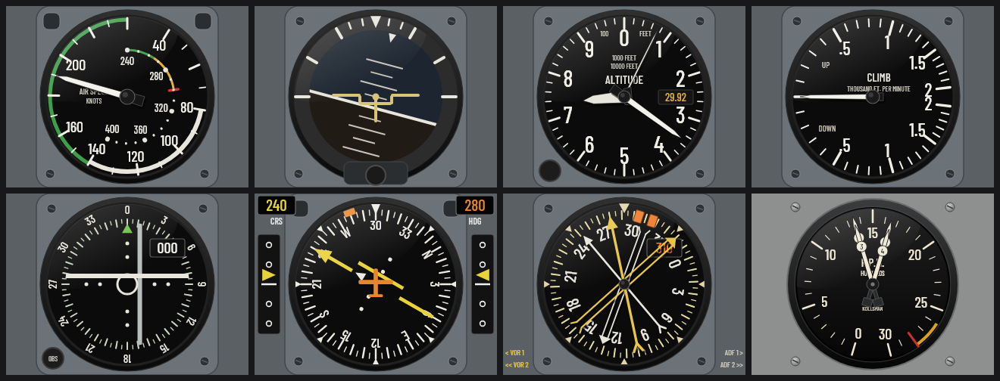

# FIPinator gauges for SPAD.neXt

**Free. Open source. Yours to change.**
180 gauges for Logitech/Saitek Flight Instrument Panels in SPAD.neXt, with knobs set up and ready to use.
No cost, no account, no catch. Licence: AGPL-3.0: use it, change it, share it. If you share a changed version,
share its source too, so it stays free for everyone.

## What's a FIP?

A FIP is the **Logitech (formerly Saitek) Flight Instrument Panel**: a small USB screen (320 x 240) with six
buttons and two knobs that sits in your home cockpit and shows one instrument at a time. It's **hardware you
have to own**, and Logitech **no longer makes it**, so today they're mostly found second-hand. These gauges are
for people who already have FIPs and run them with SPAD.neXt. They're not a free on-screen panel by themselves
(though see "No FIPs?" below).

## Made from scratch

Every gauge here was drawn and coded from scratch for this project. The look and markings come from the real
instruments and the aircraft in MSFS 2024 itself. The live values and knob commands come from the sim's own
official interface (SimConnect).

## The story

I made FIPinator for my own PMDG DC-6 in MSFS 2024, and that's mostly what I fly. The DC-6 gauges are the ones
I really know work. I've also flown some with the Saab 340B and fixed what I found. The Boeing 727 gauges **need
more testing**: the 727 is an add-on plane (the FSS 727), and it doesn't use all of the sim's standard values the way
Asobo's planes do, so some gauges may not follow its cockpit. The rest
(classic singles and twins, Cessna 404 Titan, Caravan, 737 MAX, radios, autopilot and more) I made for fun.
**Not every gauge has been tested**: most work, some may need work, and the basic layout of every gauge is already
there, so fixing one is usually a small job. If you know your way around SPAD.neXt gauges, or have an AI helper
(the AI-README is written for it), you can fix them.

For my own daily flying I use **FIPinator Live**, the app I made from scratch that these gauges come from: it
runs my FIPs, and I use SPAD.neXt for my other gear (yoke, GPS, throttle quadrant) with the FIPs switched off in
SPAD.neXt. That's not because SPAD.neXt is bad (it's great); I built Live myself and it works for me. These SPAD
versions are for everyone who'd rather keep everything in SPAD.neXt.

Compared with the paid FIP gauges I've used, these are pretty generic. I just wanted some made for the DC-6 that
worked; all the cool bells and whistles I'll leave to the paid developers, who do great work.

I got what I wanted out of this project, so **I have no plans to keep this repo updated.** If I get bored, or if
it catches on, I might come back with my AI to look at issues and make a few more gauges, but **no promises**.
It's for the world now: use it, mod it, personalise it, fork it, make it better. I like to think there are some
great people out there who can take this to a new level.

## No PMDG 737 gauges

There are no PMDG 737 gauges here. The PMDG 737 keeps most of its data (engine numbers, autopilot panel, knobs,
autobrake) to itself, so gauges for it never matched the cockpit. That's a known limit and unlikely to change
soon. The Asobo 737 MAX gauges (Dual jet groups) do work with that plane.

## Known issues

- Some numbers lose their decimals in SPAD.neXt (for example N1 shows 20 when the plane shows 20.4). Needles and
  whole numbers aren't affected. Not fixed yet; FIPinator Live shows them right.
- On the HSIs, whether SPAD.neXt slides the course bar the right way (left/right) hasn't been checked on a FIP yet.
  The ILS/course gauges and FIPinator Live are checked.
- The Boeing 727 gauges need more testing. The 727 is an add-on (FSS), not an Asobo plane, and doesn't use all of
  the sim's standard values, so a gauge may not match its cockpit.

## Testers wanted

Try them in your planes. If something's off, **open an issue** and say which gauge, which plane and what happens.
Issues are open to everyone: someone else may have the same problem, someone may already know the fix and post
it, and I might get to it myself now and then. Found a fix? Post it in the issue, or fix it in your fork and
share it. Others will thank you.

## Made with AI

All of this was built with an AI assistant (Claude). The hard part is done and documented: how the gauges work,
how they become SPAD.neXt gauges, and the sim facts learned the hard way (which way the needles really point,
which knob commands work). **Point your own AI at this repo and at the FIPinator project** and ask it to change a
gauge: it should find its way around quickly.

**There's an AI helper readme for your AI to look at, if you choose to: [AI-README.md](AI-README.md).** It lists
everything that had to be worked around to make these gauges work in SPAD.neXt. How the SPAD.neXt versions are made:
[how the SPAD.neXt export works](https://github.com/Pribilof-Hangar/fipinator-live/blob/main/docs/spad-export.md).

## How to use them

No installer: just a zip.

1. **Download** [All gauges.zip](downloads/All%20gauges.zip): every set in one small zip (about 13 MB). That's what
   most people should grab: any gauge can be used in any plane you like, or changed to fit yours. (Each set also
   has its own zip in the [downloads](downloads) folder.) Every zip has the AI-README and the licences inside.
2. **Unzip it** somewhere that stays (for example `Documents\FIPinator SPAD gauges`), not inside SPAD.neXt's own
   folder. Don't unzip the gauge files inside it: SPAD.neXt reads them as they are.
3. In SPAD.neXt, open a FIP's gauge list > **Add location** > pick the folder you unzipped.
4. Pick a gauge: they're listed under "FIPinator: ...". Page up/down flips between the gauges on a FIP.

To update: download again and replace the folder.

## SPAD.neXt settings that may help

In SPAD.neXt: **Settings > Devices > Saitek/Logitech devices > FIP Configuration**. I haven't tried these with
these gauges, and SPAD.neXt's docs don't explain them, so this is going by their names. If you try one, say in an
issue what happened.

- **Boost FIP rendering (more CPU use!)**: may make fast needles smoother (the altimeter in a climb, say), at
  the cost of more CPU. Try it if a gauge looks jerky.
- **Use default paging buttons**: SPAD.neXt seems to keep the page up/down buttons for flipping between gauges
  while this is on. Worth trying off if a gauge's own buttons don't seem to do anything.
- **Virtual power support**: probably blanks the FIPs while the plane has no electrical power.

If you fly something you care about with SPAD.neXt (your own profiles and panels), note these settings before you
change them, so you can put them back.

## Works with

Made for **Windows 11 and MSFS 2024**. The gauges use the sim's standard values and commands, so they *might*
work in MSFS 2020, but nobody has tried. Study-level planes (PMDG and others) may ignore some standard knob
commands.

**No FIPs?** The paid version of SPAD.neXt can show FIP gauges in a window on another screen, with no FIP
hardware at all ("virtual FIPs"). Just a suggestion: I haven't tried it with these gauges, and I'm not sure the
option still works; I've only seen it in this [YouTube tutorial](https://www.youtube.com/watch?v=Wn3m-spXex4).
But with AI, just about anything is possible now.

## Not all of them are realistic

Most gauges follow the real instrument. Some obviously don't, on purpose: they're made for pilots with only a
few FIPs, to squeeze more onto one screen and make flying feel good. For example, an RMI with four needles
(VOR 1, VOR 2, ADF 1 and ADF 2) or all four engines' numbers on one page. Use what you like and skip the rest.

## The original: FIPinator

These are a port of the gauges in **FIPinator Live**, a free app that runs them on your FIPs without SPAD.neXt,
plus extras SPAD.neXt can't do (flip gauges with the left knob, flip them by themselves, knob modes, layouts). Its
accessory, **FIPinator 3000**, changes panels and gauges and can save them for SPAD.neXt too.
[FIPinator Live](https://github.com/Pribilof-Hangar/fipinator-live) | [FIPinator 3000](https://github.com/Pribilof-Hangar/fipinator-3000) | [download FIPinator Live](https://github.com/Pribilof-Hangar/fipinator-live/releases)

## The gauges

- [**Airbus style**](gauges/Airbus%20style/README.md): 6 gauges
- [**Autopilot and radios**](gauges/Autopilot%20and%20radios/README.md): 3 gauges
- [**Boeing style**](gauges/Boeing%20style/README.md): 2 gauges
- [**Cessna 404 Titan**](gauges/Cessna%20404%20Titan/README.md): 7 gauges
- [**Classic radios and nav**](gauges/Classic%20radios%20and%20nav/README.md): 6 gauges
- [**Classic single**](gauges/Classic%20single/README.md): 16 gauges
- [**Classic twin**](gauges/Classic%20twin/README.md): 17 gauges
- [**DC-6**](gauges/DC-6/README.md): 49 gauges (flown with on real FIPs)
- [**Dual jet**](gauges/Dual%20jet/README.md): 13 gauges
- [**Dual jet (round gauges)**](gauges/Dual%20jet%20%28round%20gauges%29/README.md): 5 gauges
- [**Dual turboprop**](gauges/Dual%20turboprop/README.md): 8 gauges (partly flown with)
- [**Gear, flaps and trim**](gauges/Gear,%20flaps%20and%20trim/README.md): 3 gauges
- [**Single turboprop**](gauges/Single%20turboprop/README.md): 6 gauges
- [**Triple jet (Boeing 727)**](gauges/Triple%20jet%20%28Boeing%20727%29/README.md): 34 gauges (needs more testing: add-on plane)
- [**Warnings and lights**](gauges/Warnings%20and%20lights/README.md): 2 gauges
- [**Weather and small gauges**](gauges/Weather%20and%20small%20gauges/README.md): 3 gauges

## Licences

- Gauges: GNU AGPL-3.0 (`LICENSE`).
- The digits are drawn in the Barlow Condensed font: SIL Open Font License 1.1 (`OFL.txt`).
- All artwork original. Not made by or affiliated with SPAD.neXt, Logitech, Microsoft or PMDG.