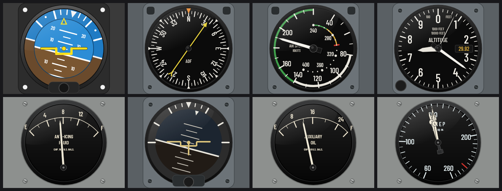

# DC-6

**Flown with on real FIPs** (SPAD.neXt, MSFS 2024, the PMDG DC-6). These are the gauges this project was made for.

49 gauges. **Download this set: [DC-6.zip](../../downloads/DC-6.zip)**, unzip it, and add the folder in SPAD.neXt (see the [front page](../../README.md)). Or get every set at once: [All gauges.zip](../../downloads/All%20gauges.zip).

| Gauge | | About it |
|---|---|---|
| **Attitude (standard style)** |  | Standard-style attitude indicator: blue sky and brown ground; outer ring with bank marks (10, 20, 30, 45, 60 degrees) that turns with bank under a fixed yellow pointer; inner ball that also moves with pitch (3 px per degree), with a numbered pitch ladder; yellow miniature airplane that the knobs move up and down (attitude bars). |
| **DC-6 ADF** |  | Fixed-card ADF: needle to the beacon, card turned with the knobs. |
| **DC-6 Airspeed** |  | Two-turn airspeed indicator in DC-6 style: 40-240 kt on the first turn (outer numbers), 240-400 kt on the second (inner numbers). Scale angles and colored ranges read from the sim's cockpit by eye; check against the PMDG DC-6. |
| **DC-6 Altimeter** |  | Three-hand altimeter in DC-6 style: long hand 100 ft per digit (1000 ft per turn), wide hand 1000 ft per digit, thin hand 10,000 ft per digit, and a pressure window in inches of mercury. |
| **DC-6 Anti-icing fluid** |  | PMDG DC-6 anti-icing fluid, overhead middle panel. Scale and marks as in DC-6 Gauges (read off the PMDG cockpit); needles follow PMDG's own cockpit needle values. |
| **DC-6 Attitude** |  | Gyro horizon in DC-6 style: dark face, horizon bar that turns with bank and moves with pitch (3 px per degree), pitch lines every 5 degrees, gull-wing miniature airplane that the knobs move up and down (attitude bars), and a bank scale with pointer at the top. Pitch and bank directions still need checking in the sim. |
| **DC-6 Auxiliary oil** |  | PMDG DC-6 auxiliary oil, overhead middle panel. Scale and marks as in DC-6 Gauges (read off the PMDG cockpit); needles follow PMDG's own cockpit needle values. |
| **DC-6 BMEP 1-4** |  | 4 needles on one dial, combined from: DC-6 BMEP 1, DC-6 BMEP 2, DC-6 BMEP 3, DC-6 BMEP 4. |
| **DC-6 Cabin supercharger oil pressure** |  | PMDG DC-6 cabin supercharger oil pressure, overhead middle panel. Scale and marks as in DC-6 Gauges (read off the PMDG cockpit); needles follow PMDG's own cockpit needle values. |
| **DC-6 Cabin supercharger oil temperature** |  | PMDG DC-6 cabin supercharger oil temperature, overhead middle panel. Scale and marks as in DC-6 Gauges (read off the PMDG cockpit); needles follow PMDG's own cockpit needle values. |
| **DC-6 Carburetor air temperature 1-4** |  | Two gauges side by side: DC-6 Carburetor air temperature 1-2 and DC-6 Carburetor air temperature 3-4. |
| **DC-6 Clock** |  | Panel clock showing the sim's local time. |
| **DC-6 Course - ILS** |  | Course indicator in DC-6 style for NAV 1: course card turned by the OBS, vertical bar for VOR/localizer deviation (or GPS track deviation when the GPS drives NAV 1, with an amber GPS light), horizontal bar for glideslope, TO/FROM triangles, a digital course readout, and red flags when there's no localizer or glideslope signal. |
| **DC-6 Cylinder head temperature 1-4** |  | Two gauges side by side: DC-6 Cylinder head temperature 1-2 and DC-6 Cylinder head temperature 3-4. |
| **DC-6 EGT** |  | PMDG DC-6 EGT: 4 engines, numbered needles; red line 1650. |
| **DC-6 Engines (all in one)** |  | PMDG DC-6: RPM, manifold pressure and BMEP dials with numbered needles, and a table of exact numbers per engine (RPM, MP, BMEP, fuel flow). |
| **DC-6 Flap position** |  | PMDG DC-6 flap position, main panel. Scale and marks as in DC-6 Gauges (read off the PMDG cockpit); needles follow PMDG's own cockpit needle values. |
| **DC-6 Free air temperature** |  | PMDG DC-6 free air temperature, main panel. Scale and marks as in DC-6 Gauges (read off the PMDG cockpit); needles follow PMDG's own cockpit needle values. |
| **DC-6 Fuel flow 1-4** |  | 4 needles on one dial, combined from: DC-6 Fuel flow 1-2, DC-6 Fuel flow 3-4. |
| **DC-6 Fuel pressure 1-4** |  | Two gauges side by side: DC-6 Fuel pressure 1-2 and DC-6 Fuel pressure 3-4. |
| **DC-6 Fuel quantity 1 alternate** |  | PMDG DC-6 fuel quantity 1 alternate, overhead middle panel. Scale and marks as in DC-6 Gauges (read off the PMDG cockpit); needles follow PMDG's own cockpit needle values. |
| **DC-6 Fuel quantity 1 main** |  | PMDG DC-6 fuel quantity 1 main, overhead middle panel. Scale and marks as in DC-6 Gauges (read off the PMDG cockpit); needles follow PMDG's own cockpit needle values. |
| **DC-6 Fuel quantity 2 alternate** |  | PMDG DC-6 fuel quantity 2 alternate, overhead middle panel. Scale and marks as in DC-6 Gauges (read off the PMDG cockpit); needles follow PMDG's own cockpit needle values. |
| **DC-6 Fuel quantity 2 main** |  | PMDG DC-6 fuel quantity 2 main, overhead middle panel. Scale and marks as in DC-6 Gauges (read off the PMDG cockpit); needles follow PMDG's own cockpit needle values. |
| **DC-6 Fuel quantity 3 alternate** |  | PMDG DC-6 fuel quantity 3 alternate, overhead middle panel. Scale and marks as in DC-6 Gauges (read off the PMDG cockpit); needles follow PMDG's own cockpit needle values. |
| **DC-6 Fuel quantity 3 main** |  | PMDG DC-6 fuel quantity 3 main, overhead middle panel. Scale and marks as in DC-6 Gauges (read off the PMDG cockpit); needles follow PMDG's own cockpit needle values. |
| **DC-6 Fuel quantity 4 alternate** |  | PMDG DC-6 fuel quantity 4 alternate, overhead middle panel. Scale and marks as in DC-6 Gauges (read off the PMDG cockpit); needles follow PMDG's own cockpit needle values. |
| **DC-6 Fuel quantity 4 main** |  | PMDG DC-6 fuel quantity 4 main, overhead middle panel. Scale and marks as in DC-6 Gauges (read off the PMDG cockpit); needles follow PMDG's own cockpit needle values. |
| **DC-6 Fuel** |  | Two-tank fuel gauge, 500 gallons per tank, red band near empty. |
| **DC-6 Heading** |  | Directional gyro: compass card under a fixed lubber line and airplane, heading bug. Right knob: align with the compass. Left knob: heading bug. |
| **DC-6 HSI** |  | HSI: compass card, heading bug, course arrow with deviation bar, TO/FROM, glideslope scales on both sides, NAV flag, CRS and HDG readouts. Right knob: course. Left knob: heading bug. |
| **DC-6 Hydraulic reservoir** |  | PMDG DC-6 hydraulic reservoir, overhead middle panel. Scale and marks as in DC-6 Gauges (read off the PMDG cockpit); needles follow PMDG's own cockpit needle values. |
| **DC-6 Manifold pressure 1-4** |  | 4 needles on one dial, combined from: DC-6 Manifold pressure 1-2, DC-6 Manifold pressure 3-4. |
| **DC-6 Oil pressure 1-4** |  | Two gauges side by side: DC-6 Oil pressure 1-2 and DC-6 Oil pressure 3-4. |
| **DC-6 Oil quantity 1-4** |  | Two gauges side by side: DC-6 Oil quantity 1-2 and DC-6 Oil quantity 3-4. |
| **DC-6 Oil temperature 1-4** |  | Two gauges side by side: DC-6 Oil temperature 1-2 and DC-6 Oil temperature 3-4. |
| **DC-6 Pitot scoop heater ammeter** |  | PMDG DC-6 pitot scoop heater ammeter, overhead middle panel. Scale and marks as in DC-6 Gauges (read off the PMDG cockpit); needles follow PMDG's own cockpit needle values. |
| **DC-6 Radar altimeter** |  | Radar altimeter 0-2,500 ft with decision-height bug and DH light. Knobs set the decision height. |
| **DC-6 RMI (ADF)** |  | Radio magnetic indicator in DC-6 style: compass card turning with heading, single-line needle for ADF 1 and double-line needle for ADF 2. Needles rest at 3 o'clock when their ADF has no signal. |
| **DC-6 RMI (VOR 1 + VOR 2 + ADF 1 + ADF 2)** |  | Four-needle radio magnetic indicator for panels with fewer FIPs: compass card turning with heading, yellow needles point to the VOR 1 (single line) and VOR 2 (double line) stations, light needles point to the ADF 1 (single line) and ADF 2 (double line) stations. Each needle rests at 3 o'clock with no signal. Orange heading bug on the card shows the autopilot heading; the knobs move it (right 1 degree, left 10 degrees per click); its setting also shows as 3 digits in the upper right. |
| **DC-6 RMI (VOR 2 + ADF 1)** |  | Radio magnetic indicator in DC-6 style: compass card turning with heading, single-line needle pointing to the VOR 2 station (VOR 1 / NAV 1 drives the course/ILS gauge), double-line needle pointing to the ADF 1 station. Each needle rests at 3 o'clock with no signal. Orange heading bug on the card shows the autopilot heading; the knobs move it (right 1 degree, left 10 degrees per click); its setting also shows as 3 digits in the upper right. |
| **DC-6 RMI (VOR)** |  | Radio magnetic indicator in DC-6 style for the VOR receivers: compass card turning with heading, single-line needle for VOR 1 and double-line needle for VOR 2, pointing to the station. Needles rest at 3 o'clock with no VOR signal. |
| **DC-6 RPM 1-4** |  | 4 needles on one dial, combined from: DC-6 RPM 1-2, DC-6 RPM 3-4. |
| **DC-6 Turn and slip** |  | Needle-type turn and slip: turn needle with standard-rate marks, white ball in a dark window. |
| **DC-6 Turn coordinator** |  | Turn coordinator: airplane symbol banks with the rate of turn (marks at a 2-minute turn), slip ball below. |
| **DC-6 Vertical Speed** |  | Vertical speed indicator in DC-6 style, in thousands of feet per minute. Level flight points to 9 o'clock; climb turns clockwise, descent anticlockwise, to 2000 ft/min each way. Scale angles read from the sim's cockpit by eye; check against the PMDG DC-6. |
| **DC-6 Water pressure 1-4** |  | Two gauges side by side: DC-6 Water pressure 1-2 and DC-6 Water pressure 3-4. |
| **DC-6 Water tanks 1-4** |  | Two gauges side by side: DC-6 Water tanks 1-2 and DC-6 Water tanks 3-4. |
| **DME 2 + GPS distance** |  | Digital readout: DME 2 distance (nautical miles), NAV 2 frequency, magnetic bearing to the NAV 2 station, and time to the station at the current groundspeed, GPS distance and time to the next waypoint, and GPS groundspeed. Shows dashes when there's no DME signal, no VOR signal (bearing only: with no VOR the sim reports radial 0), groundspeed under 30 kt (time only), or no active GPS waypoint. DME 1 belongs with the ILS on NAV 1. |

Free and open source (AGPL-3.0), made from scratch. See the [front page](../../README.md).
